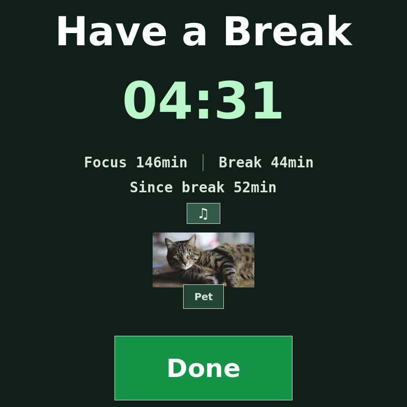
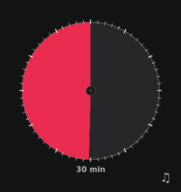
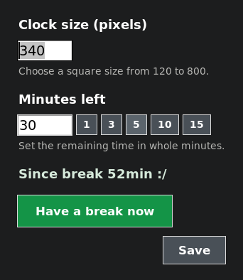

<div align="center">

# Focus2

### A focus timer that remembers to take a break. And has a cat.

<small>Should we add a dog mode?</small>

Work with a quiet, always-on-top clock. When the session ends, Focus2 fills the screen with a five-minute break, a cat to pet, and a gentle reminder of how long you have gone without a real pause.



*The break screen. Screenshot taken on an isolated display with sample stats.*

</div>

## The rhythm

1. **Focus.** A small, movable dial counts down without taking over your desktop.
2. **Pause.** When time is up, a full-screen break appears. Focus2 pauses any playing MPRIS media players and shows your break countdown.
3. **Pet the cat.** Click the cat or **Pet** to settle it, silence its reminders, and mute the default audio output. **Unpet** restores audio if Focus2 muted it.
4. **Continue when you choose.** **Done** starts the next focus session. If you leave within the first minute, Focus2 offers a shorter one-time focus period. You can also adjust the remaining break time by clicking its countdown.

Breaks can also play a local relax track automatically. Click the small **♫** button between the stats and the cat to switch it on or off. Right-click it to set the relax track's volume with a slider; that setting affects only this track and is remembered. Petting the cat, including the automatic pet at 17:00, stops the relax track; unpetting resumes it if enabled. The track also stops before your earlier music resumes.

<div align="center">
  
  &nbsp;&nbsp;
  
  <br>
  <em>The focus dial and its quick settings. Click the dial to open settings.</em>
</div>

## A break you can see

Focus2 tracks **time since the last break of at least three minutes**. Focus time accumulates across sessions; shorter breaks stay in the running total. The number appears on the break screen and in quick settings once it exceeds **45 minutes**. It measures elapsed timer time, rather than whether you were typing or looking at the screen.

This keeps the timer flexible: you can still press **Done** early or extend your focus time, but the running total makes that choice visible. Daily focus and break totals also appear on the break screen.

## Get started

Focus2 is a small Python desktop app for Linux. It needs Python 3, Tkinter, and Pillow. On Ubuntu, you can install the required packages with:

```bash
sudo apt install python3-tk python3-pil python3-pil.imagetk
```

Then run it from this directory with your preferred focus duration in minutes:

```bash
./focus2 30
```

The cat images and sound are loaded beside the `focus2` script, so keep those files together. The timer can run without the optional media tools, but these enable the full experience:

To add personal break music, place an MP3 beside `focus2` with a name beginning `relax-01 - `. Number later tracks `relax-02 - `, `relax-03 - `, and so on. Focus2 currently loops the first numbered track during breaks; these personal music files are kept out of Git.

| Tool | What it adds |
| --- | --- |
| `playerctl` | Pauses playing MPRIS media during a break and resumes the players Focus2 paused when you finish it. |
| `pactl` | Mutes the default output when you pet the cat, restores its previous audible state when you unpet it, and adjusts only the relax track's stream volume. |
| `cvlc` or `ffplay` | Plays the bundled cat reminder sound and a local break music track. |

## Controls

| Where | Action |
| --- | --- |
| Focus dial | Click to open quick settings, set the minutes left, resize the clock, or start a break immediately. |
| Break countdown | Click to set a different remaining break length. |
| Cat or **Pet** button | Pet or unpet the cat. |
| Break music button | Left-click to toggle the relax track; right-click to set its volume. |
| **Done** button | Finish the break and return to focus. |
| Command line | Use `./break-control` to inspect or control the running timer. |

The command-line controller accepts:

```text
./break-control       Show status and commands
./break-control s     Start a break now
./break-control d     Finish the break and start a 30-minute focus timer
./break-control 7.5   Set the remaining break time to 7.5 minutes
./break-control m     Pet the cat and mute audio
./break-control um    Unpet the cat and restore audio
```

Focus2 saves daily totals under `~/.local/state/focus2/` (or `$XDG_STATE_HOME/focus2/`) and window settings in `settings.json` there. It does not upload your timer data.

## Development and releases

Keep the desktop timer running from `focus-linux`. Make changes in the separate
`focus-linux-dev` worktree. Run `scripts/dev-app 30` there to see a timer marked
**DEV**. It has its own control socket, daily stats, and settings; it never
pauses media, plays sounds, or changes system volume. Use `scripts/dev-client`
to control that timer. The normal `break-control` command still controls the
production timer.

After testing and committing changes in the development worktree, run
`python3 scripts/release.py --dry-run`, then `python3 scripts/release.py --tested`.
The release pushes the development commit to GitHub main and fast-forwards the
production checkout. Immediately before the production source changes, it
records the live mode and seconds remaining. The restarted timer restores that
mode and subtracts the few seconds spent restarting, so an active focus or
break continues at approximately the same point. The release verifies the
restored timer and reports its remaining seconds.

---

<div align="center"><strong>Focus, break, pet, repeat.</strong></div>
